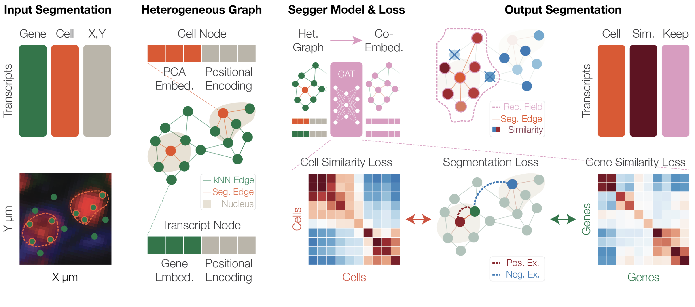

# segger

[](https://github.com/dpeerlab/segger/releases)
[](LICENSE)
[](https://segger-segmentation.readthedocs.io/en/latest/)
[](https://www.python.org/)
[](https://developer.nvidia.com/cuda-toolkit)
[](https://github.com/NVIDIA/cuspa)

Cell segmentation for imaging-based spatial transcriptomics as graph-based transcript–cell assignment.



> Segger is a graph neural network (GNN)-based method that formulates cell segmentation in imaging-based spatial transcriptomics (iST) as a problem of transcript–cell assignment. Rather than relying solely on geometric proximity, Segger assumes that a transcript belongs to a cell if it is consistent both with its local spatial context and with the gene expression programs that define cell identity, as captured in a shared latent representation.
>
> — [Heidari, Moorman, et al., segger methods description](segger_methods.pdf)

> [!NOTE]
> This release uses [`cuspa`](https://github.com/NVIDIA/cuspa), which we developed together with NVIDIA, to support atera-scale,
> billion-transcript whole-transcriptome datasets. It requires CUDA 13 and Python 3.13.

Full documentation - installation, quickstart, outputs, API reference, etc.:
[segger-segmentation.readthedocs.io](https://segger-segmentation.readthedocs.io/en/latest/)

## Installation

**segger** requires CUDA 13 and Python 3.13.

Clone the repo, then use `conda` or `pixi`:

```bash
git clone https://github.com/dpeerlab/segger.git && cd segger
```

```bash
# conda
conda env create -n segger -f environment.yml
conda activate segger

# pixi
pixi install
pixi shell
```

Alternatively, install directly from GitHub without cloning:

```bash
pip install --extra-index-url https://pypi.nvidia.com --extra-index-url https://download.pytorch.org/whl/cu130 git+https://github.com/dpeerlab/segger.git
```

## Usage

```bash
segger segment \
  -i /path/to/your/ist/data/ \
  -o /path/to/save/outputs/

# export different data formats (e.g. boundaries, spatialdata, anndata, xeniumranger, ...)
segger export boundaries \
  -s /path/to/save/outputs/segger_segmentation.parquet \
  -o /path/to/export/

# export spatialdata. transcripts are added to the existing sdata
segger export spatialdata \
  -s /path/to/save/outputs/segger_segmentation.parquet \
  --sdata /path/to/sdata.zarr

# for Xenium data to visualise in xenium explorer
segger export xeniumranger \
  -s /path/to/save/outputs/segger_segmentation.parquet \
  -i /path/to/your/ist/data/ \
  -o /path/to/export/
```

See [notebooks/quickstart.ipynb](notebooks/quickstart.ipynb) for an end-to-end walkthrough.

## Contributing

See [CONTRIBUTING.md](CONTRIBUTING.md).

## Methods description

[Heidari, E., Moorman, A., et al. Segger: Fast and accurate cell segmentation of imaging-based spatial transcriptomics data. Methods description (2026).](segger_methods.pdf)

## Citation

If you use segger in your research, please cite:

```bibtex
@misc{heidari2026segger,
  title={Segger: Fast and accurate cell segmentation of imaging-based spatial transcriptomics data},
  author={Heidari, Elyas and Moorman, Andrew and others},
  note={Methods description},
  year={2026},
  howpublished={\url{https://github.com/dpeerlab/segger/blob/main/segger_methods.pdf}}
}
```
