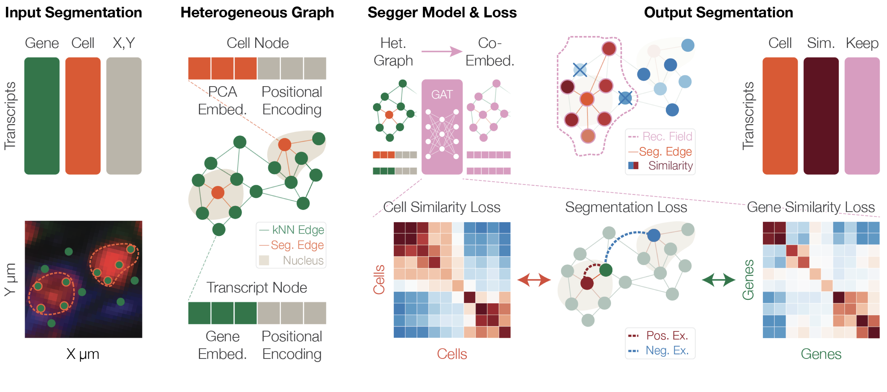

# segger

GNN-based cell segmentation of spatial transcriptomics data.



> Segger is a graph neural network (GNN)-based method that formulates cell segmentation in imaging-based spatial transcriptomics (iST) as a problem of transcript–cell assignment. Rather than relying solely on geometric proximity, Segger assumes that a transcript belongs to a cell if it is consistent both with its local spatial context and with the gene expression programs that define cell identity, as captured in a shared latent representation.
>
> — [Heidari, Moorman, et al., segger methods description](segger_methods.pdf)

> [!IMPORTANT]
> **Latest cuspa-accelerated segger:** the version used for the manuscript, which scales to billion-transcript
> whole-transcriptome datasets (e.g. Atera) using NVIDIA `cuspa`, is available as
> [release **v0.4.0-manuscript**](https://github.com/dpeerlab/segger/releases/tag/v0.4.0-manuscript).
> It requires CUDA 13 and Python 3.13 and is **not yet stable**. To install it:
>
> ```bash
> git clone --branch v0.4.0-manuscript https://github.com/dpeerlab/segger.git && cd segger
> pixi install   # or: conda env create -n segger -f environment.yml
> ```
>
> The instructions below install the stable release on `main`.

Full documentation - installation, quickstart, outputs, API reference, etc.:
[segger-segmentation.readthedocs.io](https://segger-segmentation.readthedocs.io/en/latest/)

## Installation

pixi with Python 3.11 (conda and Python 3.13 support coming soon):

```bash
curl -fsSL https://pixi.sh/install.sh | sh
git clone https://github.com/dpeerlab/segger.git
cd segger
pixi install -e cuda121
```

## Usage

```bash
# run segger segmentation
segger segment \
  -i /path/to/your/ist/data/ \
  -o /path/to/save/outputs/

# export different data formats (e.g. boundaries, spatialdata, anndata, xeniumranger, ...)
segger export boundaries \
  -s /path/to/save/outputs/segger_segmentation.parquet \
  -o /path/to/export/
```

See [notebooks/quickstart.ipynb](notebooks/quickstart.ipynb) for an end-to-end walkthrough.

## Contributing

See [CONTRIBUTING.md](CONTRIBUTING.md).

## Methods description

[Heidari, E., Moorman, A., et al. Segger: Fast and accurate cell segmentation of imaging-based spatial transcriptomics data. Methods description (2026).](segger_methods.pdf)

## Citation

If you use segger in your research, please cite:

```bibtex
@misc{heidari2026segger,
  title={Segger: Fast and accurate cell segmentation of imaging-based spatial transcriptomics data},
  author={Heidari, Elyas and Moorman, Andrew and others},
  note={Methods description},
  year={2026},
  howpublished={\url{https://github.com/dpeerlab/segger/blob/main/segger_methods.pdf}}
}
```
