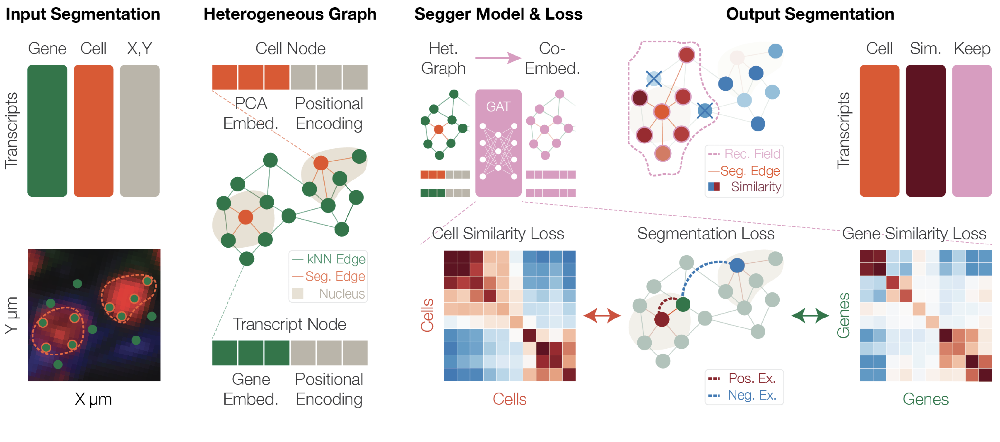

segger
======

Cell segmentation for imaging-based spatial transcriptomics as graph-based transcript–cell assignment.

.. epigraph::

   Segger is a graph neural network (GNN)-based method that formulates cell segmentation in imaging-based spatial transcriptomics (iST) as a problem of transcript–cell assignment. Rather than relying solely on geometric proximity, Segger assumes that a transcript belongs to a cell if it is consistent both with its local spatial context and with the gene expression programs that define cell identity, as captured in a shared latent representation.

   -- `Heidari, Moorman, et al., segger methods description <https://github.com/dpeerlab/segger/blob/main/segger_methods.pdf>`_

.. note::

   This release uses `cuspa <https://github.com/NVIDIA/cuspa>`_, which we developed together with NVIDIA, to support atera-scale,
   billion-transcript whole-transcriptome datasets. It requires CUDA 13 and Python 3.13.

`Methods description <https://github.com/dpeerlab/segger/blob/main/segger_methods.pdf>`_ | `GitHub <https://github.com/dpeerlab/segger>`_

Contributing
------------

See `CONTRIBUTING.md <https://github.com/dpeerlab/segger/blob/main/CONTRIBUTING.md>`_.

Citation
--------

If you use segger in your research, please cite:

    Heidari, E., Moorman, A., et al. Segger: Fast and accurate cell segmentation of imaging-based spatial transcriptomics data. Methods description (2026). https://github.com/dpeerlab/segger/blob/main/segger_methods.pdf

.. code-block:: bibtex

   @misc{heidari2026segger,
     title={Segger: Fast and accurate cell segmentation of imaging-based spatial transcriptomics data},
     author={Heidari, Elyas and Moorman, Andrew and others},
     note={Methods description},
     year={2026},
     howpublished={\url{https://github.com/dpeerlab/segger/blob/main/segger_methods.pdf}}
   }

.. toctree::
   :maxdepth: 3
   :hidden:

   installation
   how-to
   outputs
   common-issues
   api/index
