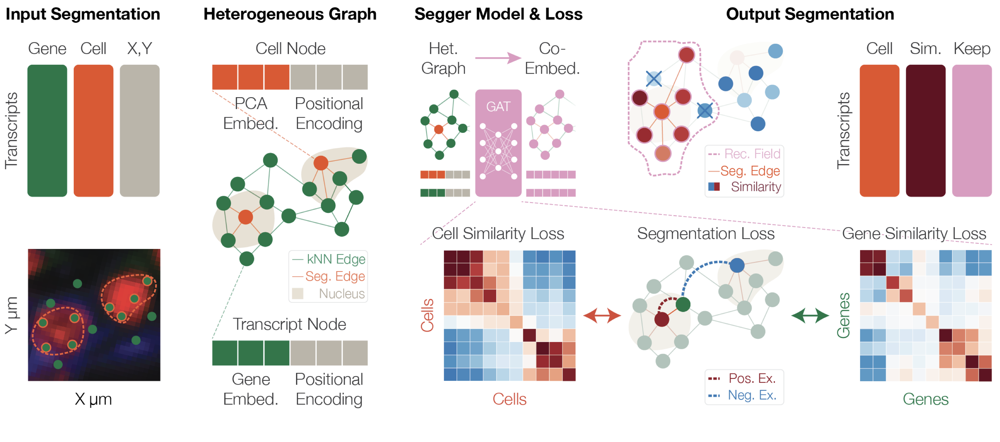

segger
======

GNN-based cell segmentation of spatial transcriptomics data.

.. epigraph::

   Segger is a graph neural network (GNN)-based method that formulates cell segmentation in imaging-based spatial transcriptomics (iST) as a problem of transcript–cell assignment. Rather than relying solely on geometric proximity, Segger assumes that a transcript belongs to a cell if it is consistent both with its local spatial context and with the gene expression programs that define cell identity, as captured in a shared latent representation.

   -- `Heidari, Moorman, et al., segger methods description <https://github.com/dpeerlab/segger/blob/main/segger_methods.pdf>`_

.. important::

   **Latest cuspa-accelerated segger:** the version used for the manuscript, which scales to
   billion-transcript whole-transcriptome datasets (e.g. Atera) using NVIDIA ``cuspa``, is available as
   `release v0.4.0-manuscript <https://github.com/dpeerlab/segger/releases/tag/v0.4.0-manuscript>`_.
   It requires CUDA 13 and Python 3.13 and is **not yet stable**. Install it with
   ``git clone --branch v0.4.0-manuscript https://github.com/dpeerlab/segger.git && cd segger && pixi install``.

`Methods description <https://github.com/dpeerlab/segger/blob/main/segger_methods.pdf>`_ | `GitHub <https://github.com/dpeerlab/segger>`_

Contributing
------------

See `CONTRIBUTING.md <https://github.com/dpeerlab/segger/blob/main/CONTRIBUTING.md>`_.

Citation
--------

If you use segger in your research, please cite:

    Heidari, E., Moorman, A., et al. Segger: Fast and accurate cell segmentation of imaging-based spatial transcriptomics data. Methods description (2026). https://github.com/dpeerlab/segger/blob/main/segger_methods.pdf

.. code-block:: bibtex

   @misc{heidari2026segger,
     title={Segger: Fast and accurate cell segmentation of imaging-based spatial transcriptomics data},
     author={Heidari, Elyas and Moorman, Andrew and others},
     note={Methods description},
     year={2026},
     howpublished={\url{https://github.com/dpeerlab/segger/blob/main/segger_methods.pdf}}
   }

.. toctree::
   :maxdepth: 2
   :hidden:

   installation
   how-to
   outputs
   notebook
   common-issues
   api/index
